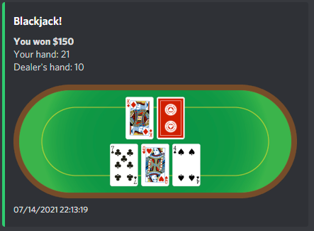
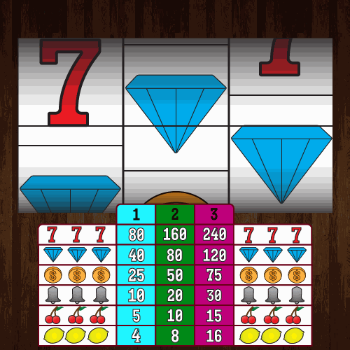

# Casino Bot
Casino bot is a gambling discord bot I made for my friends.

It plays blackjack, slots, coinflip and dice (plus player-vs-player coinflip and dice challenges). Players buy chips with bank money (`/cashier`, `/buy`, `/cashout`) and every game bets chips. Balances are stored in an SQLite3 database.

Feel free to download and use for yourself!

## Installation

1. Create a bot application on [Discord](https://discord.com/developers)
2. Have [Python 3.7](https://python.org) or later installed.
3. Clone the repository
4. Install requirements from [requirements.txt](requirements.txt)
5. Configure [config.yml](config.yml)
6. Run it: `python discord/bot.py`, or `docker compose up -d --build`

